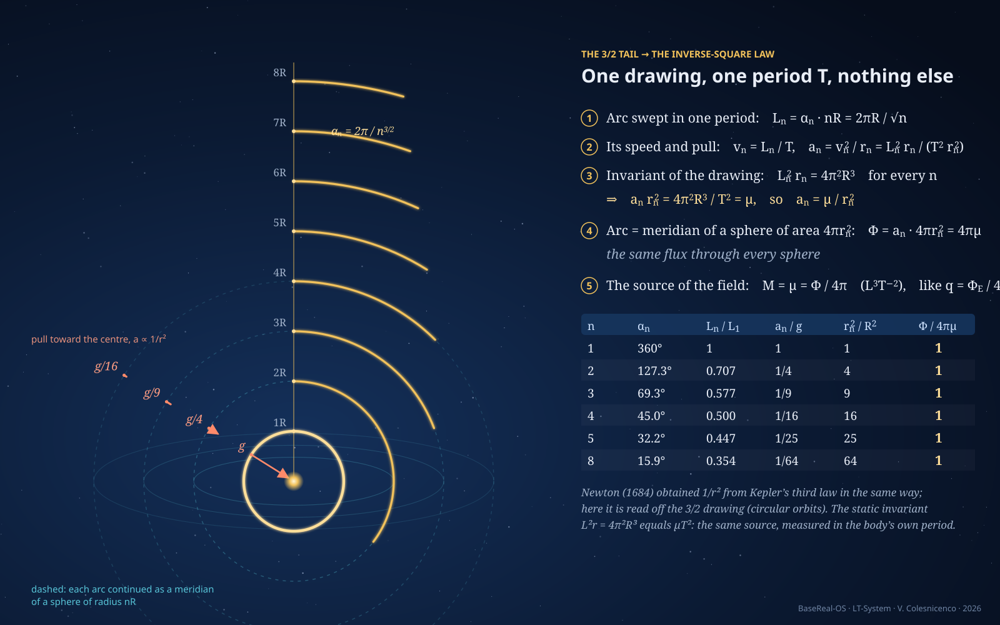

# BaseReal-OS

**A universe built from two numbers.**
Every body is set by its radius **R** and its surface orbital period **T**. Mass, gravity, density, orbits, days and years follow from them through one law: Kepler's third law read as the **inverse 3/2 law**, P = T·(a/R)^{3/2}.

| Body = two numbers | One law | No hidden constants |
|---|---|---|
| R (length) and T (time) | P = T·(a/R)^{3/2} | μ = 4π²R³/T², G = 1, ρ = 3π/T² |

BaseReal-OS is a space game in the browser where the physics is real. Most space games fake their orbits, and most physics software is not a game; this project sits in between. You build stars, planets and moons, and what you see — years, days, seasons, moons that stay or get lost — is real celestial mechanics, computed from two numbers per body. Every quantity is expressed in length and time only (an LT system, after Bartini). At galaxy scale the game borrows from astronomical observations and turns them into mechanics: it does not claim to explain them.

A one-person, independent project, built in spare time. The papers below are preprints, not peer-reviewed.

---

## Interactive demos

All demos are single HTML files: open them online or download and double-click.

| Demo | What it shows |
|---|---|
| **[Genesis](https://vitalydecoder.github.io/BaseReal-OS/demo/genesis.html)** | The main sandbox. Build stars, binary stars, planets, moons and moons of moons from R and T; real periods, seasons, axial tilt, Hill spheres. Two modes: *Genesis* (guided) and *Limitless* (no limits, no undo: bodies leave orbit, bounce, collide). Six languages. |
| **[Kepler 3/2 tool](https://vitalydecoder.github.io/BaseReal-OS/demo/kepler-3-2-tool.html)** | Kepler's third law as geometry: arcs of radius n·R and length 2π/n^{3/2} show how far a body travels in one period T at each distance. |
| **[Bernoulli in LT cells](https://vitalydecoder.github.io/BaseReal-OS/demo/bernoulli-lt.html)** | An ideal fluid in a pipe written with R and T only: continuity, the LT clock T ∝ R³ and the constant head ½v² + p/ρ. Where the pipe narrows, the word *pressure* shrinks with the pressure. Six languages. |
| **[Galaxy Booster](https://vitalydecoder.github.io/BaseReal-OS/demo/galaxy-booster.html)** | 3D. One booster at the heart of a young galaxy slowly releases stars; it turns slowly and its nozzle precesses, and a spiral galaxy with star clusters, nebulae and dust lanes grows from nothing. Rotate, zoom, fly into the core. Six languages, phone-friendly. |

## Papers

Preprints on Zenodo. The English texts are in [`docs/`](docs/). The two papers on adaptive perception come as a pair on purpose: one starts from perception, the other from rendering.

| Paper | Text | DOI |
|---|---|---|
| Inverse 3/2 Law: a geometric interpretation of Kepler's third law | [PDF](docs/Inverse-3-2-Law.pdf) | [10.5281/zenodo.19799606](https://doi.org/10.5281/zenodo.19799606) |
| LT-System v2: a dimensional system for near-realistic simulations | [MD](docs/LT-System-v2.md) | [10.5281/zenodo.24016736](https://doi.org/10.5281/zenodo.24016736) |
| General Architecture of the BaseReal-OS Hybrid Four-Layer Computational Model | [MD](docs/General-Architecture-4-Layer.md) | [10.5281/zenodo.22060039](https://doi.org/10.5281/zenodo.22060039) |
| Duet of Algorithms: a two-process architecture of threshold transitions (v2.0) | [MD](docs/Duet-of-Algorithms.md) · [code](code/duet-vix-replication/) | [10.5281/zenodo.20804271](https://doi.org/10.5281/zenodo.20804271) |
| Adaptive Perception and Lazy Rendering | [MD](docs/Adaptive-Perception-Lazy-Rendering.md) | [10.5281/zenodo.21283080](https://doi.org/10.5281/zenodo.21283080) |
| Adaptive Perceptual Resolution: a relative information scale for living systems | [MD](docs/Adaptive-Perceptual-Resolution.md) | [zenodo.org/records/20376632](https://zenodo.org/records/20376632) |
| Galaxy Booster v2: growing a spiral galaxy from one rotating, precessing source | [PDF](docs/Galaxy-Booster.pdf) · [MD](docs/Galaxy-Booster.md) · [code](code/galaxy-booster/) | [10.5281/zenodo.24406046](https://doi.org/10.5281/zenodo.24406046) |

## Reproducibility

- [`code/duet-vix-replication/`](code/duet-vix-replication/) — one Python script reproduces every number in Section 8 of *Duet of Algorithms* (VIX spikes 1990–2026, surrogate tests).
- [`code/galaxy-booster/`](code/galaxy-booster/) — the numbers and Figure 2 of *Galaxy Booster v2* (Python, no dependencies). Figures 1, 3–5 are frames of the demo opened with links such as `demo/galaxy-booster.html#t=150&view=core`.
- Genesis computes everything from R and T at run time; the Solar System is built from measured radii and GM values, so its years, months and days come out real.

## Roadmap

| Stage | Status |
|---|---|
| **01 Sandbox** — build bodies from R and T, real celestial mechanics in the browser | open: [Genesis](https://basereal-os.dev) |
| **02 Founders** — an interactive universe: ignite stars, push planets, send stars across the galaxy | design |
| **03 Miners** — real matter: dig into planets; matter is defined by what players need for cities and ships | concept |
| **04 State registry** — a universe that keeps a registry of states and computes only what is observed | concept |

## Status and limitations

- The physics core is classical Newtonian gravity rewritten in length and time. It reproduces known orbits; it does not claim new physics.
- The Galaxy Booster is a game mechanic inspired by observations (stars ejected by central black holes, star formation in outflows), not a model of real galaxies.
- Genesis moves bodies along analytic orbits ("on rails"), not by N-body integration.

## Cite

See [`CITATION.cff`](CITATION.cff), or use the DOI of the paper you rely on.

## License

Code: [MIT](LICENSE). Papers: as stated on their Zenodo records.

**Author:** Vitali Colesnicenco · [basereal-os.dev](https://basereal-os.dev) · [github.com/VitalyDeCoder/BaseReal-OS](https://github.com/VitalyDeCoder/BaseReal-OS)
