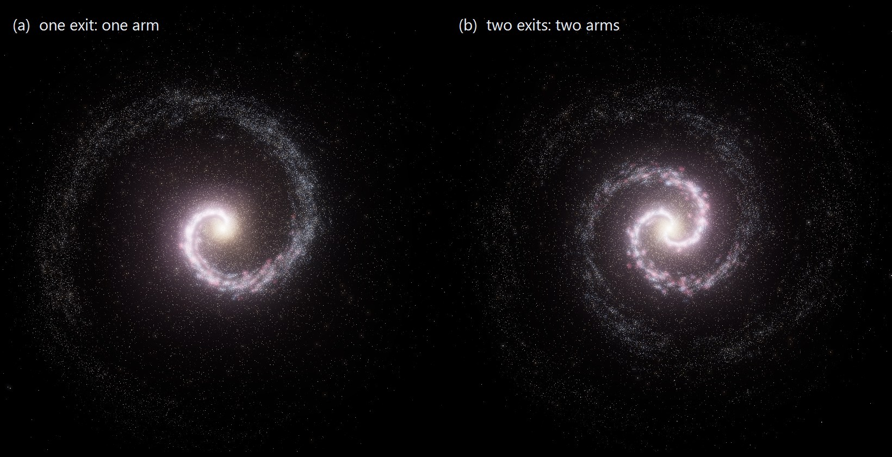
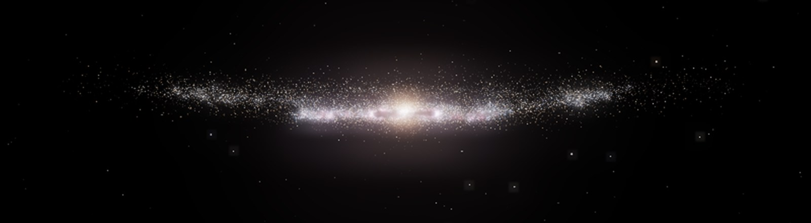
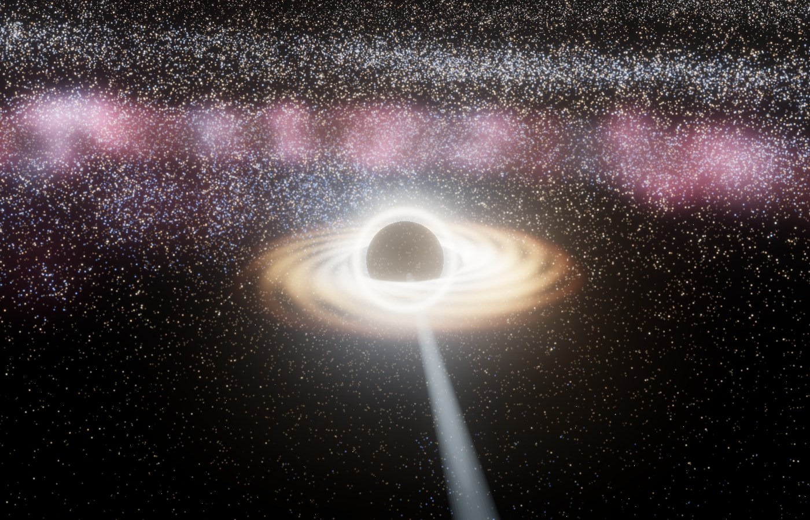

<!-- kicker: BaseReal-OS · Preprint · Version 2 -->
<!-- formulas: $r = (R_0 + C)\,e^{K a} - C$ | $\theta = \Phi(t) - (\Omega_n - \omega_s)\,a$ | $\tan\psi \approx K/(\Omega_n - \omega_s)$ -->
<!-- running: Galaxy Booster · v2 · V. Colesnicenco · 2026 -->
<!-- watermark: Ω -->
<!-- keeptables: 12 -->
# Galaxy Booster: Growing a Spiral Galaxy from One Rotating, Precessing Source

**A generative game mechanic for BaseReal-OS, adapted from observations (Version 2, November 2026)**

**Author:** Vitali Colesnicenco

**Independent Researcher, London, United Kingdom**

Previous version: v1, *Black Hole as Galactic Speed Booster: An Alternative to Dark Matter*, Zenodo, 2026 — <https://zenodo.org/records/20377051>

DOI: <https://doi.org/10.5281/zenodo.24406046>

Interactive model: <https://vitalydecoder.github.io/BaseReal-OS/demo/galaxy-booster.html>

> **What changed from v1.** Version 1 proposed that the central black hole "boosts" stars and so replaces dark matter. Version 2 withdraws that claim (Section 7 gives the reason in one line: a circular orbit needs the inward acceleration $v^2/r$ at every radius, and a push from the centre does not supply it). The booster is now what it works best as: a **game mechanic**. One source at the centre of a young galaxy slowly releases stars, slowly turns, and its nozzle slowly precesses; the stars it releases draw a spiral galaxy that grows from nothing in front of the player. Version 2 gives the mechanic in closed form, maps every parameter to what the player sees, lists the observations it borrows, and ships as a 3D interactive model.

## Abstract

BaseReal-OS builds a universe that a player can watch and shape. Its rule for borrowing from astronomy is simple: **observations are adapted to the game; the game does not claim to explain them.** This paper applies that rule to galaxies. A single *booster* sits at the centre: a black hole with a nozzle that releases stars at a constant rate. Each star drifts outward as $r = (R_0 + C)e^{Ka} - C$, where $a$ is its age, and orbits at a constant angular speed $\omega_s$. The nozzle turns at $\Omega_n$ and its tilt precesses at $\Omega_p$. Because the release direction turns while the stars drift, the stars released during one star-life lie on a logarithmic spiral that rotates rigidly with the booster. With the default values the arm makes 1.6 turns from centre to rim, the pitch angle falls from 16° at 0.3 radii to 11° at the rim (observed spirals span roughly 5–30° [Kennicutt 1981]), the surface density falls about as steeply as an exponential disk of scale 0.35 galaxy radii, and the precessing nozzle warps the disk by 9% of its radius at the rim, about 1.3 kpc for a 15-kpc disk. The number of nozzle exits sets the number of arms. Star clusters, nebulae around large clusters, dust lanes on the inner edge of the arms, an old disk and a bulge are added as layers on the same formula. Every position is computed in closed form on the graphics card from the time and a handful of numbers, so a whole galaxy of about 170,000 particles is stored as about ten numbers and a random seed, and the cost of drawing it does not grow with its age.

## 1. Design principle

BaseReal-OS already builds stars, planets and moons from two numbers each, radius and period, linked by the inverse 3/2 law [Colesnicenco 2026a; 2026b]. The next scale up is the galaxy. A game universe needs galaxies that look right, grow in front of the player and respond to a few understandable controls. It does not need a solved theory of galaxy formation. BaseReal-OS therefore takes observed phenomena as **ingredients** and turns them into mechanics, keeping what is visible and recognisable and changing what would make the game slow or opaque. Section 6 lists every ingredient used here, what the game takes from it and what it changes. Section 7 states plainly what the mechanic does not claim about real galaxies.

## 2. The mechanic

### 2.1 Release and drift

The booster releases stars at a constant rate. A star released $a$ seconds ago is at radius (in units of the galaxy radius)

$$r(a) = (R_0 + C)\,e^{K a} - C, \qquad K = \frac{1}{L}\ln\frac{R_{\max} + C}{R_0 + C},$$

where $R_0$ is the release radius, $L$ the life of a star from release to the rim $R_{\max}$, and $C$ a softening radius. The radial speed $\dot r = K (r + C)$ is slow near the centre and grows outward, so stars linger in the middle and the galaxy has a bright core. With a constant release rate the steady surface density is

$$\Sigma(r) \propto \frac{1}{r\,(r + C)},$$

flat-ish inside $C$ and close to $1/r^2$ outside. Between 0.3 and 1.0 galaxy radii it falls by a factor of 7.4, the same drop as an exponential disk [Freeman 1970] of scale 0.35 radii (Figure 2b).

### 2.2 Rotation and the spiral

The nozzle direction is $\Phi(t)$, which turns at $\Omega_n$; each star keeps the direction it was released in and then orbits at $\omega_s$. A star of age $a$ is at angle

$$\theta = \Phi(t) - \Omega_n a + \omega_s a + \frac{2\pi k}{m} + \delta,$$

where $k$ labels the nozzle exit, $m$ is the number of exits and $\delta$ a small random scatter. At a fixed moment all stars of one exit lie on the curve

$$\theta - \Phi(t) = -\frac{\Omega_n - \omega_s}{K}\,\ln\frac{r + C}{R_0 + C},$$

a logarithmic spiral in $r + C$. Its pitch angle $\psi$ obeys

$$\tan\psi = \frac{K\,(r + C)}{(\Omega_n - \omega_s)\,r} \;\to\; \frac{K}{\Omega_n - \omega_s} \quad (r \gg C),$$

and one arm makes $(\Omega_n - \omega_s)L/2\pi$ turns from release to the rim. The whole pattern turns rigidly at the booster's rate $\Omega_n$, while each star moves outward along its arm. A faster booster winds the arms tighter (Figure 2a):

| Booster turn | Turns of one arm | Pitch at 0.6 radii |
|---|---|---|
| 35 s | 2.86 | 6.9° |
| **55 s (default)** | **1.61** | **12.1°** |
| 90 s | 0.76 | 24.3° |

The range covers the pitch angles of real spirals, from tightly wound Sa to open Sc galaxies [Kennicutt 1981]. The number of arms equals the number of nozzle exits $m$ (Figure 3).

![Figure 2. The mechanic in two curves. (a) One arm at a fixed moment for three booster spins; a faster booster winds the arm tighter. (b) Surface density of released stars, Σ ∝ 1/[r(r + C)] (solid), against an exponential disk of scale 0.35 galaxy radii matched at 0.3 radii (dashed).](figures/galaxy-booster-fig2.svg)

### 2.3 Precession: a warped, corrugated disk

The nozzle is tilted by $\varepsilon(t) = \varepsilon_0 \sin\Psi(t)$ out of the disk plane, and the phase $\Psi$ turns at the precession rate $\Omega_p$. A star keeps the tilt it was released with:

$$z = 0.85\, r \sin\!\big[\varepsilon_0 \sin(\Psi(t) - \Omega_p a)\big] + \text{thickness}.$$

Stars released at different moments leave at different tilts, so the disk is not flat: it bends up on one side and down on the other, and the bend travels around the galaxy as the nozzle precesses (Figure 4). With $\varepsilon_0 = 6°$ the rim rises 0.089 galaxy radii out of the plane, 1.3 kpc for a 15-kpc disk. Real disks, the Milky Way among them, are warped by about this much, and the Milky Way's warp precesses [Poggio et al. 2020]. With a precession period of 170 s and a star-life of 120 s, each arm carries 0.7 of a vertical wave.

### 2.4 Layers: clusters, nebulae, dust, old disk, bulge

The same formula drives five layers that differ only in scatter, brightness and colour:

| Layer | Particles | Rule |
|---|---|---|
| Arm stars | 80,000 | released in clusters; cluster sizes follow a steep power law (most stars in small groups, a few clusters of up to 80); 38% are released alone |
| Nebulae | ≤ 1,600 | one pink or blue glow per 22 stars of every cluster larger than 16, visible from 2% to 55% of the cluster's life |
| Dust | 11,000 | dark, released like arm stars but placed on the inner edge of the arm, visible in the middle of the life |
| Old disk | 60,000 | same release, but scattered by more than a radian around the arm, so it forms a smooth disk with faint arms |
| Bulge | 18,000 | a flattened three-dimensional cloud around the booster that brightens as the galaxy forms |

Colour follows age: arm stars are released blue, turn white by mid-life and pale yellow near the rim; a few are orange from the start. Brightness falls with age, so the inner arms are the brightest and bluest part of the galaxy, as in observed spirals.

### 2.5 Default parameters

| Symbol | Meaning | Default | What the player sees |
|---|---|---|---|
| $L$ | star life, release to rim | 120 s (480 Myr) | how long the galaxy takes to grow |
| $R_0$, $C$, $R_{\max}$ | release radius, softening, rim | 0.022, 0.28, 1.04 | size of the core, steepness of the disk |
| $K$ | drift rate | 0.0123 s⁻¹ | follows from the three above |
| $\Omega_n$ | booster spin | one turn in 55 s | how tightly the arms are wound |
| $\omega_s$ | star orbit | one turn in 210 s | how fast the stars themselves move |
| $m$ | nozzle exits | 2 | number of arms |
| $\varepsilon_0$, $\Omega_p$ | nozzle tilt, precession | 6°, one turn in 170 s | warp and corrugation of the disk |
| seed | random numbers | — | the individual look of this galaxy |

## 3. Growth

The galaxy is born empty: only the booster and its nozzle are visible. In the first seconds the released stars form short bright streams; within about 40 s they curl into arms; after one star-life the first stars reach the rim and from then on the galaxy is complete and renews itself, with old stars fading at the rim as new ones leave the nozzle (Figure 1). On the story clock of the model, 1 s = 4 Myr, the galaxy forms in about 500 Myr and the booster turns once every 220 Myr.

## 4. What the player can do

The interactive model is a single HTML file. The player can:

- rotate the galaxy, zoom from the whole disk down to the booster, and pan;
- jump to a face-on view (Top), an edge-on view (Edge, Figure 4) or fly to the booster itself (Core, Figure 5), where the black hole, its accretion disk and the nozzle beams are visible and the newly released stars stream outward;
- change the speed of time (×0.25 to ×30), the booster spin (arm winding), the precession tilt (0–16°) and the number of exits (1 or 2);
- restart a galaxy from nothing or skip ahead until it is grown.

A view can be shared as a link: for example `#t=150&view=top` opens a grown galaxy face-on, and `&ui=0` hides the interface. The figures in this paper were made that way.

## 5. Implementation

Every quantity above is a closed-form function of the current time $t$, the booster's turn angle $\Phi(t)$, the precession phase $\Psi(t)$ and the particle's own random numbers (release time, scatter, brightness, colour, exit). The positions are therefore computed in the vertex shader on the graphics card; the processor only advances three numbers per frame. This has four consequences that matter for BaseReal-OS:

1. **Constant cost.** Drawing a galaxy costs the same at any age; nothing is integrated step by step.
2. **No stored state.** A galaxy is fully described by about ten parameters and a random seed. This fits the project's idea of a universe stored as a registry of seeds and laws, in which only what is observed is computed [Colesnicenco 2026c].
3. **Exact replay.** Any moment of a galaxy's history can be shown at once by setting $t$, which is how the "skip ahead" button and the shared links work.
4. **Scale.** About 170,000 particles run at full frame rate on a desktop; on phones and weak devices the model uses half as many.

The model uses three.js [three.js 2023] with a bloom pass for the glow of bright stars. One practical lesson: a single pixel with an undefined value (for example from raising a negative number to a power in a shader) is smeared by the bloom into large black squares; the model avoids such operations and filters any such pixel before the bloom.

## 6. Observations the mechanic borrows

| Observation | What the game takes | What the game changes |
|---|---|---|
| Hypervelocity stars ejected by the Galactic Centre black hole [Hills 1988; Brown et al. 2005; Koposov et al. 2020] | a black hole that releases stars | a steady, slow stream instead of rare ejections |
| Stars forming inside fast outflows from active nuclei [Maiolino et al. 2017; Ishibashi & Fabian 2012] | stars born moving outward from the centre | all disk stars are born this way |
| A linear trail of young stars behind a runaway supermassive black hole [van Dokkum et al. 2023] | stars laid out in a line by one source | the source stays at the centre and turns |
| Spiral arms as a pattern turning at a fixed pattern speed [Lin & Shu 1964] | an arm pattern that turns rigidly | the pattern speed is the booster's spin, and stars move along the arm instead of through it |
| Pitch angles of spiral arms, about 5–30° along the Hubble sequence [Kennicutt 1981] | the range of arm winding | set directly by one slider |
| A warped disk whose warp precesses [Poggio et al. 2020] | a bend that travels around the disk | produced by the nozzle's precession |
| Exponential stellar disks [Freeman 1970] | a bright core and a fading outer disk | the profile $1/[r(r+C)]$, which matches an exponential over most of the disk |
| Young clusters and ionised nebulae along arms, dust on the inner edge | the look of a star-forming arm | placed by rule, not by gas physics |

## 7. What the mechanic does not claim

The game galaxy looks like a real one; it is not built like one. Three differences matter.

- **Real stars do not travel along the arms.** In real galaxies arms are patterns through which stars pass, and stars stay at roughly the same radius for many orbits. In the game the stars ride outward along the arms; this is what makes the galaxy grow visibly from one source.
- **The booster does not hold the galaxy together, and it does not replace dark matter.** A star on a circular orbit of radius $r$ at speed $v$ needs the inward acceleration $v^2/r$ at every moment — $2.1 \times 10^{-10}$ m s⁻² at the Sun — and a push from the centre does not provide it. This is why the dark-matter claim of version 1 is withdrawn.
- **A real black hole could not build a disk this way.** For a Milky Way-like galaxy the energy would be affordable (launch speeds of 290–540 km s⁻¹ place stars between 2 and 15 kpc; the energy is about $5 \times 10^{-4}$ of the Eddington output of Sgr A* over 10 Gyr), but the disk's angular momentum exceeds the largest possible spin of Sgr A* ($4.1 \times 10^6 M_\odot$ [GRAVITY Collaboration 2019]) by a factor of $2.5 \times 10^{11}$, and the release rate needed is about $5 \times 10^4$ times the observed rate of hypervelocity stars [Brown 2015]. The script in Data availability reproduces these numbers.

## 8. Limitations of the model as a game

- Stars orbit rigidly at one angular speed; there is no differential rotation, so arms never wind up and never break.
- One booster per galaxy; no mergers, bars, rings or interacting neighbours.
- No gravity between particles; clusters keep their shape apart from the prescribed scatter.
- Nebulae and dust are placed by rule and do not respond to the stars.

Each of these can be added as a separate mechanic without changing the closed form of the core.

## 9. Conclusion

One source at the centre that slowly releases stars, slowly turns and slowly precesses is enough to grow a convincing spiral galaxy: arms with a realistic pitch, a bright core and fading disk, a warped edge, clusters, nebulae and dust. Three numbers control what matters most to the eye — the booster's spin sets the winding, the number of exits sets the number of arms, the precession sets the warp — and the whole galaxy is a closed-form function of time that costs the same to draw at any age. As astronomy, the booster is not a model of how galaxies form. As a game mechanic built from astronomical observations, it does what BaseReal-OS needs: a galaxy the player can watch being born, explore from rim to black hole, and reshape with a few controls.

## Data availability

All files are in <https://github.com/VitalyDeCoder/BaseReal-OS>.

- Interactive model: `demo/galaxy-booster.html` (three.js, runs in a browser; open online or from disk).
- Numbers in Sections 2, 3 and 7: `code/galaxy-booster/booster_numbers.py` (Python, no dependencies).
- Figure 2: `code/galaxy-booster/fig_booster.py`. Figures 1, 3, 4 and 5 are frames of the interactive model opened with the links `#t=14|40|80|150&view=top&ui=0&orbit=0` (Figure 1), `#t=150&view=top&ui=0&noz=1` (Figure 3a), `#t=150&view=edge&ui=0` and `#t=150&view=core&ui=0`.

## References

1. Brown, W. R. (2015). Hypervelocity stars. *Annual Review of Astronomy and Astrophysics*, 53, 15–49.
2. Brown, W. R., Geller, M. J., Kenyon, S. J., & Kurtz, M. J. (2005). Discovery of an unbound hypervelocity star in the Milky Way halo. *The Astrophysical Journal*, 622, L33–L36.
3. Colesnicenco, V. (2026a). *Inverse 3/2 Law (Geometric Interpretation of Kepler's Third Law)*. Zenodo. https://doi.org/10.5281/zenodo.19799606
4. Colesnicenco, V. (2026b). *LT-System v2: A Dimensional System for Near-Realistic Simulations*. Zenodo. https://doi.org/10.5281/zenodo.24016736
5. Colesnicenco, V. (2026c). *Adaptive Perception and Lazy Rendering: Dynamic Thresholds for Computationally Efficient Rendering*. Zenodo. https://doi.org/10.5281/zenodo.21283080
6. Freeman, K. C. (1970). On the disks of spiral and S0 galaxies. *The Astrophysical Journal*, 160, 811.
7. GRAVITY Collaboration (2019). A geometric distance measurement to the Galactic center black hole with 0.3% uncertainty. *Astronomy & Astrophysics*, 625, L10.
8. Hills, J. G. (1988). Hyper-velocity and tidal stars from binaries disrupted by a massive Galactic black hole. *Nature*, 331, 687–689.
9. Ishibashi, W., & Fabian, A. C. (2012). Active galactic nucleus feedback and triggering of star formation in galaxies. *Monthly Notices of the Royal Astronomical Society*, 427, 2998–3005.
10. Kennicutt, R. C., Jr. (1981). The shapes of spiral arms along the Hubble sequence. *The Astronomical Journal*, 86, 1847–1858.
11. Koposov, S. E., et al. (2020). Discovery of a nearby 1700 km/s star ejected from the Milky Way by Sgr A*. *Monthly Notices of the Royal Astronomical Society*, 491, 2465–2480.
12. Lin, C. C., & Shu, F. H. (1964). On the spiral structure of disk galaxies. *The Astrophysical Journal*, 140, 646–655.
13. Maiolino, R., et al. (2017). Star formation inside a galactic outflow. *Nature*, 544, 202–206.
14. Poggio, E., et al. (2020). Evidence of a dynamically evolving Galactic warp. *Nature Astronomy*, 4, 590–596.
15. three.js authors (2023). *three.js*, JavaScript 3D library, release r160. https://threejs.org
16. van Dokkum, P., et al. (2023). A candidate runaway supermassive black hole identified by shocks and star formation in its wake. *The Astrophysical Journal Letters*, 946, L50.
